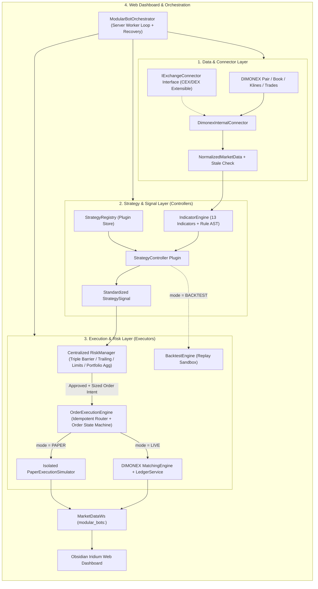
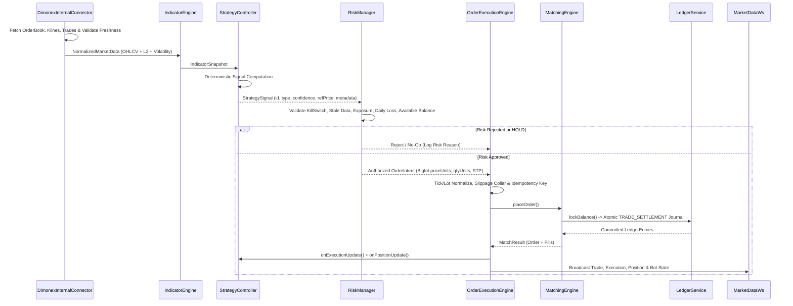
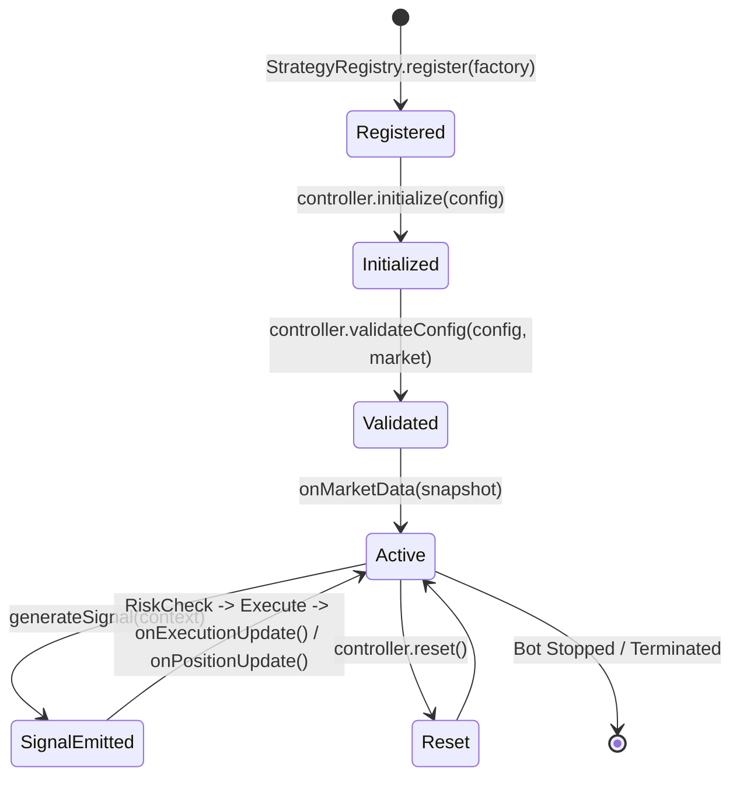
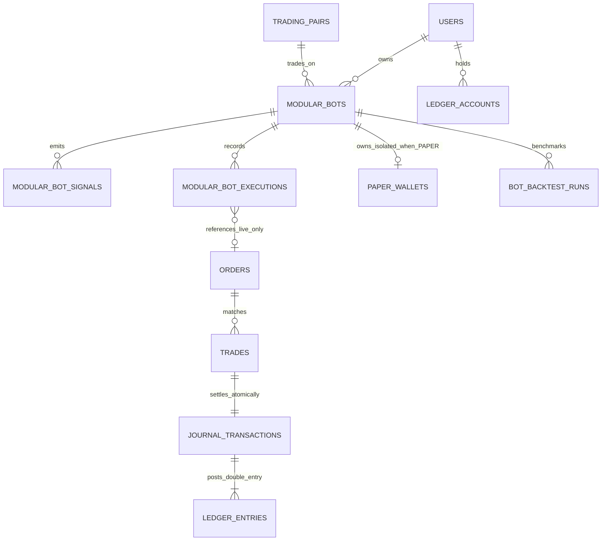
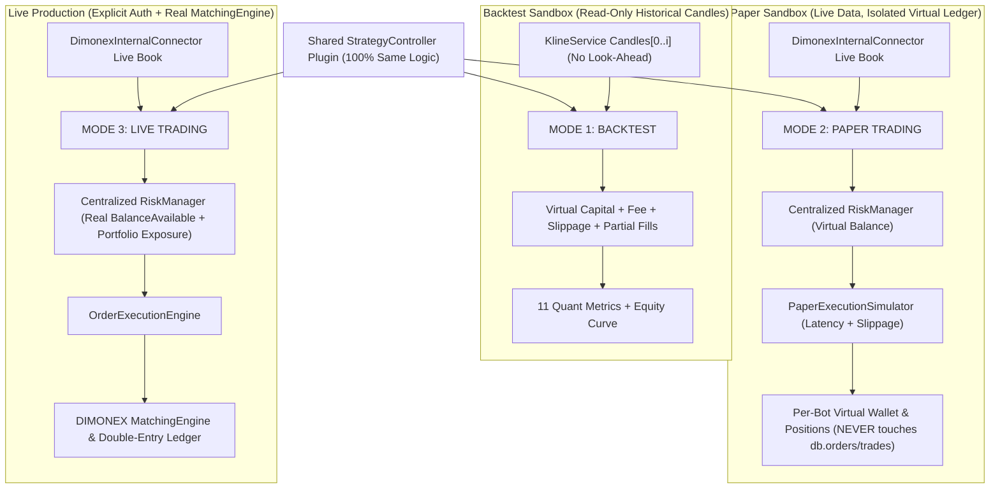
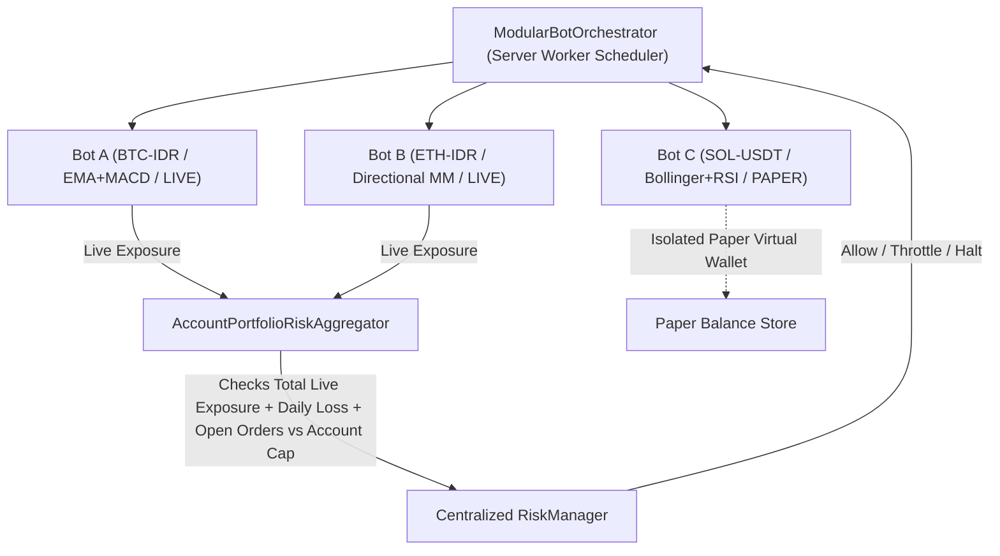

# DIMONEX — Modular Strategy Trading Bot (`MODULAR_STRATEGY_BOT`) System Design Document

**Version:** 1.0.0  
**Status:** Approved for Phased Implementation  
**Bot Type Identifier:** `MODULAR_STRATEGY_BOT`  
**Schema Version:** `1.0`

---

## 1. Executive Summary

The `MODULAR_STRATEGY_BOT` system extends the existing DIMONEX exchange algorithmic trading platform with an institutional, four-layer modular algorithmic trading architecture supporting two primary trading categories:

1. **Directional Trading** (Bollinger Bands + RSI Mean Reversion, EMA + MACD Trend Following, Supertrend, and Custom Multi-Indicator Rule Builder)
2. **Market Making & Hybrid Liquidity Management** (Directional Market Making with Inventory Skew, and Dynamic Grid / DCA)

Every strategy controller is implemented once as an isolated, deterministic plugin (`StrategyController`) and executes identically across three strictly isolated operating modes: **Backtesting**, **Paper Trading**, and **Guarded Live Trading**. Execution is decoupled from signal generation and strictly gated by a centralized server-side `RiskManager` and `OrderExecutionEngine` backed by DIMONEX's authoritative `MatchingEngine`, `LedgerService`, and `PrecisionMath` BigInt accounting.

---

## 2. Existing DIMONEX Architecture Assessment

A repository audit of DIMONEX identifies reusable core subsystems and key structural gaps:

### 2.1 Existing Assets Reused Directly
- **Matching Engine (`/server/engine/MatchingEngine.ts`, `/server/engine/OrderBook.ts`)**: Single-threaded, deterministic price-time priority (FIFO) spot order book per pair (`LIMIT` / `MARKET`, `GTC` / `IOC`), self-trade prevention (`selfTradePreventionPolicy`), atomic balance locking slices, and replayable `EngineEvent` logs.
- **Double-Entry Ledger (`/server/ledger/LedgerService.ts`)**: Enforces `Sum(Debits) === Sum(Credits)`, `Available >= 0`, `Locked >= 0`, append-only `LedgerEntry` rows, and idempotent `JournalTransaction` commits.
- **Zero-Float Arithmetic (`/server/ledger/PrecisionMath.ts`)**: Fixed-point `bigint` arithmetic for quote volume, base quantity, and basis-point fee rounding.
- **Market Data & OHLCV (`/server/engine/KlineService.ts`, `/server/services/analytics/TimeframeAnalyticsService.ts`)**: Real trade-derived candles across 13 timeframes (`1m`–`1M`) and real-time market regime detection (8 regimes), plus `MarketDataWs` (`/server/websocket/MarketDataWs.ts`) for depth, trades, ticker, order updates, and bot broadcasts.
- **Persistence (`/server/db/database.ts`)**: In-memory transactional store with atomic snapshot persistence (`exchange_state.json`) and background async flushes, plus SQL migration blueprints (`/server/migrations/`) and high-throughput Go matching experiment (`/backend-go/`).
- **Backtest & Bot Infrastructure (`/server/services/BotWorkerManager.ts`, `/server/services/backtest/HftBacktestEngine.ts`, `/src/components/bot/`)**: Existing worker lease concept and Obsidian Iridium dashboard UI patterns.

### 2.2 Architectural Gaps Addressed by `MODULAR_STRATEGY_BOT`
- Existing bot logic (e.g., `OrderBot`, `VolumeBot`, `AdvancedMarketMakerBot`) tightly couples signal computation, balance checks, and direct `matchingEngine.placeOrder()` calls.
- Lack of a plugin contract for adding new directional or market-making strategies without touching core execution or risk logic.
- No centralized server-side `RiskManager` supporting Triple Barrier (TP / SL / Time Limit), Trailing Stops, or cross-bot account-level exposure aggregation.
- No true isolated Paper Trading sandbox sharing identical strategy logic with Live Trading and Historical Backtesting.

---

## 3. Architecture Goals and Non-Goals

### 3.1 Goals
- **Strict 4-Layer Separation**: Data & Connector -> Strategy & Signal -> Risk & Execution -> Web Dashboard.
- **Zero Duplicate Core Systems**: Reuse `MatchingEngine`, `LedgerService`, `PrecisionMath`, `KlineService`, `MarketDataWs`, and `TimeframeAnalyticsService`.
- **100% Deterministic Integer/Decimal-String Accounting**: Never use floating-point numbers as authoritative balances, order sizes, or prices.
- **Strict Mode Isolation**: Zero contamination between Backtest, Paper Trading, and Live Trading balances, order books, and trade histories.
- **Guarded Live Promotion**: Paper bots require explicit confirmation and server-side balance/risk checks before transitioning to Live mode.

### 3.2 Non-Goals
- No browser-side timers (`setInterval`) to keep bots running.
- No simulated or fake leverage/futures balance manipulation on spot markets.
- No evaluation of user-supplied raw JavaScript strings in the Custom Rule Builder (declarative AST only).
- No artificial wash-volume or synthetic fill fabrication in live trading.

---

## 4. Component Responsibilities

| Layer | Module | Responsibility |
| :--- | :--- | :--- |
| **1. Data & Connector** | `MarketDataConnector` | Normalizes order book snapshots, recent trades, OHLCV candles, tickers, and volatility into `NormalizedMarketData`; detects stale feeds (`maxStalenessMs`) and validates monotonic timestamps/sequences. |
| **2. Strategy & Signal** | `StrategyRegistry`, `IndicatorEngine`, `StrategyController` plugins | Pure analysis generating standardized `StrategySignal` objects (`BUY`, `SELL`, `EXIT`, `HOLD`, or MM quote targets). Cannot place orders or mutate balances. |
| **3. Risk & Execution** | `RiskManager`, `OrderExecutionEngine`, `ModularBotOrchestrator` | Validates signals, computes position sizes, enforces Triple Barrier & Trailing Stops, aggregates account-wide bot exposure, manages order lifecycle (`POST_ONLY`, `LIMIT`, `IOC`, `FOK`, `MARKET`), and reconciles real/virtual fills. |
| **4. Control & Dashboard** | `modularBot` REST routes, `MarketDataWs`, `ModularStrategyDashboard` | Authenticated API gateway, WebSocket streaming, 8-step Wizard, Live Bot Monitor, Backtesting Lab, and Strategy Library. |

---

## 5. System Architecture Diagram



---

## 6. Data Flow Diagram

### Diagram A: End-to-End Market Data to Ledger & Trade Events



---

## 7. Strategy Controller Interface

Every strategy plugin implements `StrategyController`:

```typescript
export interface StrategyController {
  initialize(config: BotConfigSchemaV1): void;
  validateConfig(config: BotConfigSchemaV1, marketConstraints?: MarketConstraints): ConfigValidationResult;
  onMarketData(data: NormalizedMarketData): void;
  generateSignal(context: StrategyExecutionContext): StrategySignal;
  onPositionUpdate(position: BotPositionState): void;
  onExecutionUpdate(execution: BotExecutionRecord): void;
  reset(): void;
  getMetadata(): StrategyMetadata;
}
```

Mandatory guarantees:
- **Zero side-effects on exchange state**: Controllers hold only internal indicator buffers and strategy state; they never call `MatchingEngine` or `LedgerService`.
- **Expiration & Confidence**: Every generated `StrategySignal` carries `signalTimestamp`, `expiresAt`, `confidence` (`0..100`), `indicatorValues`, `referencePriceUnits`, `explanation`, and `riskMetadata`.

---

## 8. Execution Engine Interface

`OrderExecutionEngine` separates Signals from Orders and Orders from Executions:
- **Supported Order Types**: `POST_ONLY` (checks top-of-book to guarantee maker-only placement without crossing spread), `LIMIT`, `IOC`, `FOK` (all-or-none liquidity check before commitment / immediate full fill guard), and `MARKET` (protected by `maxSlippageBps` price collar).
- **Idempotency & Reconciliation**: Every submission generates a deterministic `idempotencyKey = botId:cycle:leg:nonce`. Partial fills increment `filledQtyUnits` strictly from `MatchResult.trades` records; an unexecuted `Order` never increments trade volume or realized PnL.

---

## 9. Risk Manager Interface

`CentralizedRiskManager` evaluates every signal and active position across:
1. **Triple Barrier Method** (eligible Directional positions):
   - Take Profit (`takeProfitBps` or absolute price), Stop Loss (`stopLossBps` or absolute price), Maximum Holding Duration (`maxHoldingSeconds`).
   - Market Making bots are explicitly exempted from blanket position-level TP/SL on resting quotes and instead enforce quote-level staleness, spread bounds, and `maxInventoryBase` caps.
2. **Trailing Stop & Break-Even**:
   - Integer basis-point peak-tracking (`highWaterMarkUnits` / `lowWaterMarkUnits`) with `activationBps`, `distanceBps`, `stepBps`, and `breakEvenActivationBps` + `breakEvenOffsetBps`.
3. **Position Sizing & Available Balance**:
   - `FIXED_QTY`, `FIXED_QUOTE`, `PERCENT_BALANCE`, `RISK_PER_TRADE`.
   - Validates `account.balanceAvailable` (never total balance), `minOrderSize`, `maxOrderSize`, lot step, tick step, `maxNotional`, and `maxOpenOrders`.
4. **Global & Portfolio Account-Level Risk Controls**:
   - Server-side checks for `maxDailyLoss`, `maxDrawdownPct`, `maxPositionSize`, `maxExposureQuote` aggregated across all running bots owned by the same `ownerUserId`, `maxActiveBotsPerAccount`, `maxOrderFrequencyPerMin`, `maxSlippageBps`, stale data circuit breaker, and emergency account/global kill-switch.
5. **Derivatives Separation (`DerivativesExecutionAdapter`)**:
   - Spot-first enforced. Derivatives remain non-executable unless a dedicated margin matching engine, funding ledger, and liquidation engine are registered.

---

## 10. Connector Interface

`IExchangeConnector` abstracts market feeds cleanly:
- `getMarketSnapshot(pairId, timeframe, limit)`: Returns `NormalizedMarketData` (L2 order book, recent trades, candles, ticker, ATR/realized volatility, timestamp, sequence number, staleness flag).
- `validateFreshness(snapshot, maxAgeMs)`: Ensures stale or non-monotonic feeds halt order generation safely.
- **Primary Implementation**: `DimonexInternalConnector` (zero-latency in-process adapter over `OrderBook`, `KlineService`, `db.trades`, and `TimeframeAnalyticsService`).
- **Extensible Contract**: Future external CEX/DEX connectors implement `IExchangeConnector` and explicit capability flags (`supportsPostOnly`, `supportsFok`, `supportsShorting`). Unsupported external stubs reject explicitly instead of faking connectivity.

---

## 11. Strategy Plugin Registry & Lifecycle

### Diagram D: Strategy Plugin Lifecycle



Built-in plugins registered on boot:
1. `bollinger_rsi` (`DIRECTIONAL`) — Bollinger Bands + RSI Mean Reversion.
2. `ema_macd` (`DIRECTIONAL`) — Fast/Slow EMA Crossover + MACD Momentum.
3. `supertrend` (`DIRECTIONAL`) — ATR-based Trend & Reversal Detector.
4. `custom_rule_builder` (`DIRECTIONAL`) — Declarative Multi-Indicator AST Builder (13 indicators, 9 operators, no `eval`).
5. `directional_market_making` (`MARKET_MAKING`) — Bid/Ask Post-Only Quoting with Inventory Skew & Regime/Volatility Adaptation.
6. `dynamic_grid_dca` (`HYBRID`) — Fixed/ATR-Adaptive Limit Grid + Available-Funds-Only DCA.

---

## 12. Standard Configuration Schema

All bots validate against `BotConfigSchemaV1` (`schemaVersion: "1.0"`):
- `bot`: `{ name, category: 'DIRECTIONAL' | 'MARKET_MAKING' | 'HYBRID', strategyId, strategyVersion, tradingPair, mode: 'BACKTEST' | 'PAPER' | 'LIVE' }`
- `market`: `{ timeframe, dataSource: 'DIMONEX', priceReference: 'LAST_TRADE' | 'MIDPOINT' | 'BEST_BID' | 'BEST_ASK', maxDataAgeMs }`
- `strategy`: `{ indicators: Record<string, number | boolean | string>, entryRules: RuleNode[], exitRules: RuleNode[], params: Record<string, any> }`
- `execution`: `{ orderType: 'POST_ONLY' | 'LIMIT' | 'IOC' | 'FOK' | 'MARKET', timeInForce, postOnly, maxSlippageBps, orderTimeoutSeconds, retryCount }`
- `risk`: `{ positionSizing: { method, value }, tripleBarrier: { enabled, takeProfitBps, stopLossBps, maxHoldingSeconds }, trailingStop: { enabled, activationBps, distanceBps, stepBps, breakEvenActivationBps, breakEvenOffsetBps }, limits: { maxOpenOrders, maxPositionBase, maxNotional, maxDailyLoss, maxDrawdownPct, maxOrdersPerMinute } }`

---

## 13. Database Entity Relationship Diagram



*Storage durability*: Persisted in `db.modularBots` & `db.modularBacktestRuns` (`exchange_state.json` snapshot store) with PostgreSQL-ready relational DDL mappings for horizontal scaling.

---

## 14. API Endpoint Design

Authenticated REST API under `/api/modular-bots` (requires `requireAuth` and strict resource-ownership verification):
- `GET /api/modular-bots/strategies` — List registered strategy plugin metadata & config schemas.
- `GET /api/modular-bots/overview` — Account KPIs (Active, Directional, Market Making, Paper, Live, Realized/Unrealized PnL, Aggregate Exposure, Risk Status).
- `GET /api/modular-bots` — List user's modular bot instances (filterable by `mode`, `category`, `status`).
- `POST /api/modular-bots` — Validate schema v1.0 & create a new `MODULAR_STRATEGY_BOT`.
- `POST /api/modular-bots/:id/start` — Start bot (LIVE mode checks authorization + available balance + explicit confirmation).
- `POST /api/modular-bots/:id/pause` — Pause worker without dropping position state; optionally cancel open resting quotes.
- `POST /api/modular-bots/:id/resume` — Resume paused worker after fresh risk & data checks.
- `POST /api/modular-bots/:id/stop` — Stop bot safely and cancel all bot-owned open orders (`matchingEngine.cancelOrder` or Paper simulator).
- `POST /api/modular-bots/:id/emergency-stop` — Immediate halt + mandatory cancel all open orders + risk lock.
- `POST /api/modular-bots/:id/promote-live` — Requires `{ confirmLivePromotion: true, acknowledgementToken }` to transition `PAPER -> LIVE` with fresh risk & balance audit.
- `DELETE /api/modular-bots/:id` — Delete stopped bot record (refuses if `RUNNING`).
- `GET /api/modular-bots/:id/details` — Signals, active positions, open orders, executions, logs, risk utilization.
- `POST /api/modular-bots/backtest` — Execute isolated historical backtest (plus optional grid optimization) and return full metrics & equity curve.
- `GET /api/modular-bots/backtests` — List historical backtest runs for user.

---

## 15. WebSocket Event Design

Reuses `/ws` `MarketDataWebSocketService` with channel `modular_bots:<userId>`:
- `modular_bot_snapshot` — Initial list of user's modular bots on subscribe.
- `modular_bot_updated` — Incremental bot state, position, PnL, and open order updates.
- `modular_bot_signal` — Real-time emitted `StrategySignal` with indicator values and rationale.
- `modular_bot_execution` — Confirmed fill / order event (tagged explicitly `mode: 'PAPER' | 'LIVE'`).

---

## 16–18. Backtesting, Paper Trading, and Live Trading Architectures

### Diagram B: Three Operating Modes & Strict Isolation



---

## 19. Multi-Bot Orchestration

### Diagram C: Multi-Bot Orchestration & Account Risk Aggregation



Key orchestration invariants:
- Single active timer per `botId` (duplicate worker lock prevents double scheduling).
- Restart recovery automatically reloads `db.modularBots`: `LIVE` bots running before restart verify risk/kill-switch state before resuming cleanly; stale resting orders are reconciled against `db.orders`.
- Each bot maintains isolated configuration, Paper wallet (`paperBalances`), open order IDs (`activeOrderIds`), execution ledger (`executions`), position state (`position`), signal history, and logs.

---

## 20. Security and Authorization
- Every `/api/modular-bots/*` endpoint requires authenticated session via `requireAuth` (or admin override where applicable).
- Strict owner check (`bot.ownerUserId === req.user.id`): users can never inspect, pause, stop, or promote bots belonging to another account.
- Custom Multi-Indicator Builder validates indicator names, numeric bounds, and operator enums against a closed allowlist—zero dynamic `eval`, `new Function`, or untrusted expression execution.
- Server-side risk & balance checks cannot be bypassed by crafted HTTP payloads.

---

## 21–24. Performance, Failure Recovery, Observability, and Testing
- **Performance**: Indicator windows are bounded to necessary lookback candles (max 300 candles/tick); snapshot writes coalesce asynchronously via `db.scheduleSave()`.
- **Failure Recovery**: Consecutive error tracking automatically moves failing bots into `ERROR` or `RISK_HALTED` and cancels resting open orders to prevent orphaned exposure.
- **Observability**: Per-bot structured logs (`INFO`, `SIGNAL`, `ORDER`, `FILL`, `RISK`, `ERROR`) plus Prometheus/observability metrics compatible with `/metrics`.
- **Testing**: Automated verification suite (`/server/tests/test_modular_strategy_bot.ts`) tests determinism, zero look-ahead bias, AST rule validation, Triple Barrier & Trailing Stop triggers, Paper vs Live isolation, BigInt precision, account-level exposure caps, and restart recovery.

---

## 25–26. Migration, Deployment, and Rollback Plan
1. Add `'MODULAR_STRATEGY_BOT'` alongside existing `BotType` values without altering any legacy `ORDER_BOT`, `VOLUME_BOT`, `ADVANCED_MM`, or `SMART_HFT_LADDER` flows.
2. Persist `modularBots` and `modularBacktestRuns` as optional collections on `PersistedExchangeState` (backward-compatible snapshot loading).
3. **Rollback**: Feature-clean route isolation allows disabling `/api/modular-bots` and pausing `modularBotOrchestrator` without affecting spot trading, copy trading, earn vaults, or existing bots.
